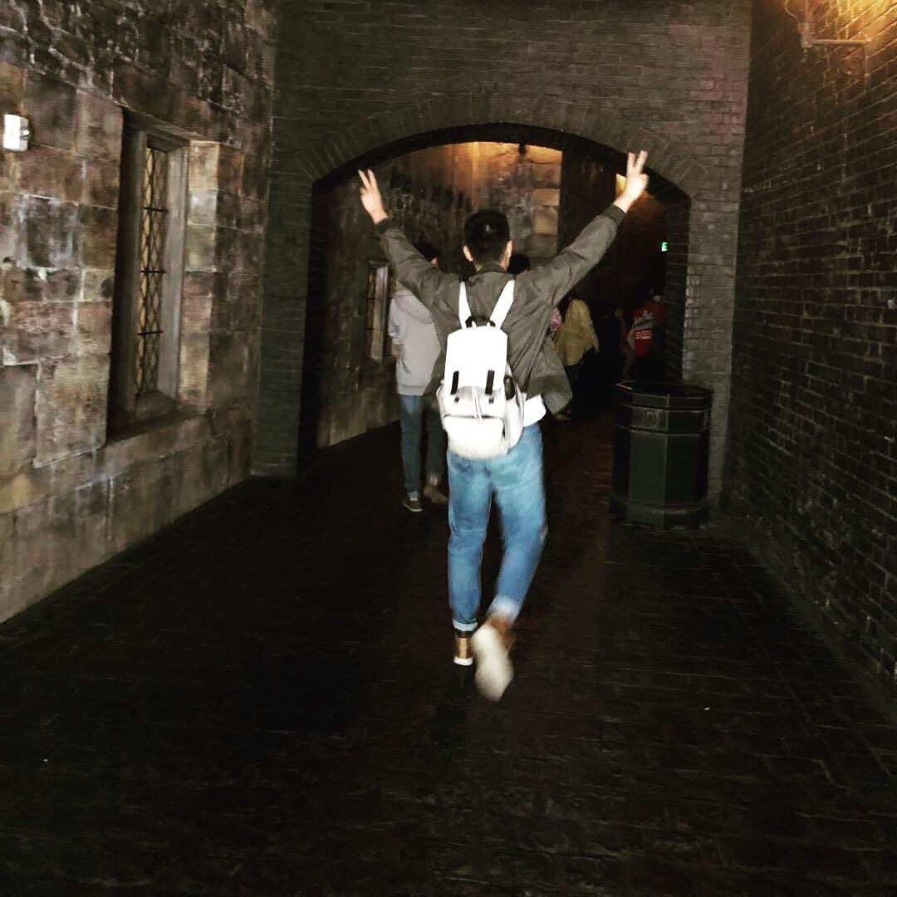

<!-- {: width="350px" style="float:right; padding-left:30px" }  -->

# About Me        
* I am currently a Postdoctoral Fellow at the [University of Hong Kong](https://www.cds.hku.hk/), working with [Prof. Yi Ma](https://people.eecs.berkeley.edu/~yima/). Previously, I received my Ph.D. in [EECS](https://eecs.engin.umich.edu/) from the [University of Michigan](https://umich.edu/), where I was fortunate to be advised by [Prof. Qing Qu](https://qingqu.engin.umich.edu/).

* My research interests lie in representation learning, focusing particularly on the identification and effective utilization of low-dimensional structures and dynamics of deep networks. Besides, I'm also interested in robust deep learning, and Super-resolution microspcopy.

# News
<ul>
  <li><b>[May 2026]</b>
    Paper on <a href="https://arxiv.org/abs/2606.09718">evaluating and monitoring diffusion model training via representation space geometry</a> (<a href="https://heimine.github.io/Diffusion_ICR_REP/">project page</a>) accepted at <b>ICML 2026</b>.
  </li>
  <li><b>[Dec. 2025]</b>
    Paper on <a href="https://arxiv.org/abs/2512.20963">how balanced representation space drives generalization in diffusion models</a> (<a href="https://la0ka1.github.io/diffusion-gen-from-rep/">project page</a>) accepted at <b>ICLR 2026</b>.
  </li>
  <li><b>[Sep. 2025]</b> 
      Paper on <a href="https://arxiv.org/abs/2502.05743">diffusion-based representation learning dynamics</a> 
      accepted at <b>NeurIPS 2025</b>.
  </li>
  <li><b>[Aug. 2025]</b> 
      Paper on <a href="https://arxiv.org/abs/2311.02960">layerwise representation dynamics in deep networks</a> 
      accepted at <b>JMLR</b>.
  </li>
  <li><b>[May 2024]</b> 
      Paper on <a href="https://arxiv.org/abs/2212.12206">transfer learning and neural collapse</a> 
      accepted at <b>TMLR</b>; 
      paper on <a href="https://arxiv.org/abs/2310.15903">multi-label learning and neural collapse</a> 
      accepted at <b>ICML 2024</b>.
  </li>
</ul>

<!-- * <b>\[May 2023\]</b> I'm joining [Samsung Research America](https://sra.samsung.com/) as a Summer Research Intern.  -->

# Academic Services
* Conference Reviewer: NeurIPS 2022-2025, ICML 2022-2026, ICLR 2024-2026.
* Journal Reviewer: JMLR, TMLR

